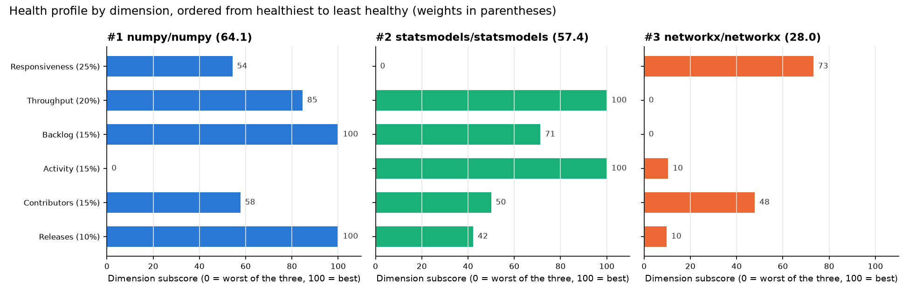
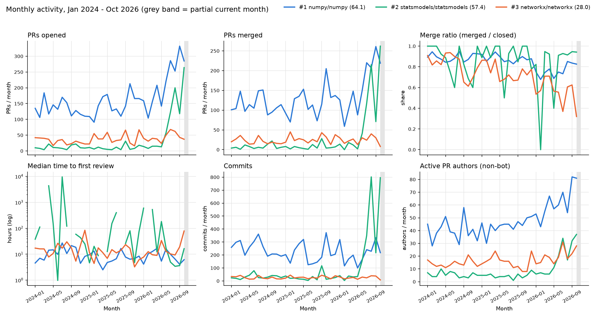
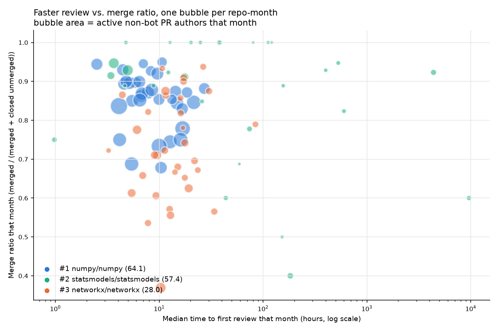

# Open Source Package Health: GitHub Data Pipeline

This project is an automated data pipeline that answers "how healthy are these open-source communities?" for numpy, networkx, and statsmodels. A single Prefect flow extracts about 34 months of commits, pull requests, reviews, and releases from the GitHub REST API (with pagination, rate-limit handling, retries, and resumable runs), loads the raw JSON into DuckDB with idempotent upserts, builds tested staging, fact, and mart models in dbt, validates the pipeline end to end in Python, scores each repo across six weighted health dimensions, and produces three visualizations.

## Setup and run

Requires Python 3.11.

```powershell
python -m venv .venv
.venv\Scripts\activate
pip install -r requirements.txt

$env:GITHUB_TOKEN = "<your PAT>"
python main.py
```

**Expected runtime.**
- **First (full) run: several hours.** About 7,800 requests, so it crosses the 5,000/hour rate limit and sleeps until the reset.
- **Later (incremental) runs: about 2–3 minutes.** Only records updated since the last load are fetched.

## Task 1: Extract

**Resumability** (`logs/1_extract.log`). The run was interrupted with Ctrl-C twice, then resumed:

```
18:44:32 | INFO | No data/raw/ yet: first run.
18:44:32 | INFO | Mode: full | repos: ['numpy/numpy', 'networkx/networkx', 'statsmodels/statsmodels']
          ^C  (interrupted while paging numpy commits)
18:46:17 | INFO | No _LOADED marker: last run did not finish loading. RESUMING; pages on disk will be skipped.
18:46:34 | INFO | numpy/numpy | commits: 7699 records (13 pages fetched, 64 pages already on disk)
18:48:14 | INFO | numpy/numpy | pulls: 5900 records (59 pages fetched, 0 pages already on disk)
18:48:14 | INFO | numpy/numpy | fetching reviews for 5489 PRs
          ^C  (interrupted during numpy reviews)
18:50:33 | INFO | No _LOADED marker: last run did not finish loading. RESUMING; pages on disk will be skipped.
18:50:34 | INFO | numpy/numpy | commits: 7699 records (0 pages fetched, 77 pages already on disk)
18:50:37 | INFO | numpy/numpy | pulls: 5900 records (0 pages fetched, 59 pages already on disk)
...
10:11:15 | INFO | numpy/numpy | pr_reviews: 10565 records (5440 pages fetched, 50 pages already on disk)
...
10:47:02 | INFO | Extract finished (full): 7833 API requests in 57389s
```

**Request counts.**

| Run | Requests | Log line |
| --- | --- | --- |
| Full | 7,833 | `Extract finished (full): 7833 API requests in 57389s` |
| Incremental | 147 | `Extract finished (incremental): 147 API requests in 59s` |

The incremental run made review calls only for new or updated PRs (135 of its 147 requests). Task 2 then upserted those records into the existing tables:

```
14:49:31 | INFO | raw_commits: 219 distinct records in files | rows before=11632, after=11848 (+216)
14:49:31 | INFO | raw_pull_requests: 300 distinct records in files | rows before=8500, after=8563 (+63)
14:49:33 | INFO | raw_pr_reviews: 197 distinct records in files | rows before=15535, after=15592 (+57)
14:49:33 | INFO | raw_releases: 248 distinct records in files | rows before=248, after=248 (+0)
```

**API odometer.** Every run ends by logging `API odometer: N GitHub requests this run`, counted in `fetch_page`, which every request passes through.

## Task 2: Load

**Idempotency: the same files loaded twice** (`logs/2_load.log`):

```
14:10:40 | raw_commits: 11632 distinct records in files | rows before=0, after=11632 (+11632)
14:10:44 | raw_pull_requests: 8500 distinct records in files | rows before=0, after=8500 (+8500)
14:12:22 | raw_pr_reviews: 15535 distinct records in files | rows before=0, after=15535 (+15535)
14:12:23 | raw_releases: 248 distinct records in files | rows before=0, after=248 (+248)
--- second load of the same files ---
14:12:25 | raw_commits: 11632 distinct records in files | rows before=11632, after=11632 (+0)
14:12:28 | raw_pull_requests: 8500 distinct records in files | rows before=8500, after=8500 (+0)
14:12:32 | raw_pr_reviews: 15535 distinct records in files | rows before=15535, after=15535 (+0)
14:12:32 | raw_releases: 248 distinct records in files | rows before=248, after=248 (+0)
```

## Task 3: dbt

**Bot rule** (macro `is_bot` in `macros/run_time.sql`, applied to commit authors, PR authors and reviewers):
`is_bot = user.type = 'Bot' OR user.login LIKE '%[bot]'`. A commit whose email is not linked to a GitHub account has no author, so `is_bot` is false.

**Open PRs and medians.** PRs still open at run time are kept in `fct_pull_requests` with `is_open = true` and are never given a fake close date. Their `hours_to_merge` and `hours_to_close` are NULL, so median time to merge only covers PRs that were actually merged; open PRs drop out instead of counting as zero. Additionally, a PR with no review yet has a NULL `hours_to_first_review` and is not included with the review medians, but it counts as "not reviewed" in `reviewed_within_7d`.

## Task 4: Validation

**Outliers.** Flagged records are **kept**.

- **Time to merge.** Cutoff, per repo: `log10(hours) > Q3 + 1.5 × IQR`, which is about 176 days for numpy and 128 days for statsmodels. I used the log scale because merge times range from minutes to years. A cutoff on raw hours would flag about 10% of numpy's PRs. **38 PRs flagged**, for example numpy #26214 (907 days), numpy #26255 (895 days) and statsmodels #9297 (787 days). networkx has none, because its merges are slow across the board. The full list is in `logs/4_validate.log`.
- **Weekly commits.** Cutoff, per repo: `commits > Q3 + 3 × IQR`, over every complete week including weeks with zero commits. **11 weeks flagged:** 9 statsmodels weeks from July to October 2026 (up to 362 commits, against a typical week of 6), one numpy week (171) and one networkx week (29). The statsmodels burst is not bots: one maintainer (`bashtage`) made over 1,500 commits after July 2026.
- **Why keep them.** They are real events, not data errors: long-running PRs, and a real surge of work on statsmodels. Every scored metric is a median, share or slope, so a few extreme values barely change it.

## Task 5: Health score and ranking

**Metrics** (columns of `mart_health_inputs`):

| Dimension | Metric | Definition | Healthier |
| --- | --- | --- | --- |
| Responsiveness | `median_hours_to_first_review` | Median hours from PR creation to the first review not by the author or a bot | lower |
| Responsiveness | `pct_reviewed_within_7d` | Share of PRs (created 7+ days before run time) reviewed within 168 h | higher |
| Responsiveness | `pct_merged_with_approval` | Share of merged PRs with an APPROVED non-author, non-bot review | higher |
| Throughput | `merge_rate` | merged ÷ (merged + closed unmerged), PRs created in the window | higher |
| Throughput | `median_hours_to_merge` | Median hours from creation to merge (merged PRs only) | lower |
| Backlog | `pct_open_prs_stale` | Share of open PRs with no activity in 180+ days | lower |
| Activity | `commit_trend` | `regr_slope(commits, month_index)` over complete months ÷ mean monthly commits | higher |
| Contributors | `pct_merges_by_top5_authors` | Share of human-authored merged PRs written by the 5 most active authors | lower |
| Contributors | `contributor_trend` | Same slope, for active non-bot PR authors per month | higher |
| Releases | `releases_per_year` | Releases ÷ (days in window ÷ 365.25) | higher |
| Releases | `release_interval_cv` | Std. dev. ÷ mean of days between releases (lower = more regular) | lower |

**Size normalization.** No metric is a raw count. Each is a share, a median, a rate per year, or a trend divided by the repo's own average month, so a big project cannot win just by being big.

**Trend component.** `commit_trend` and `contributor_trend` measure whether activity is growing or shrinking over the window.

**Scoring.**
1. Each metric is min-max scaled across the three repos to 0–1, flipped when lower is healthier, so 1 is always the best.
2. Metrics are averaged within their dimension and multiplied by 100 to give the dimension subscore.
3. The score is the weighted sum of the subscores.

| Dimension | Weight | Why |
| --- | --- | --- |
| Responsiveness | 25% | Responsiveness shows how quickly a project replies, so quicker replies would make a healthier project and it is one of the first thing contributors look at |
| Throughput | 20% | Throughput shows whether or not PRs actually get merged and how long they take, so healthier projects would actually merge changes |
| Backlog | 15% | Lots of old, ignored PRs means the maintainers can't keep up and PRs are not being addressed |
| Activity (trend) | 15% | Activity on a package would show if it is growing or shrinking. If people stop using it, it could point to being unhealthy |
| Contributors | 15% | Contributors can also point to health as more people contributing can be a sign of a healthier package, especially if that number is growing |
| Releases | 10% | Lowest weight, because each project picks its own release schedule. Regular releases still show the project is being kept up to date. |

## Task 6: Plots

Each repo has the same color in every plot: numpy blue, networkx orange, statsmodels aqua.

**[1_dimension_profile.png](plots/1_dimension_profile.png)**



The profiles explain why the ranking is not a just the biggest project being the best. numpy is strong almost everywhere except its flat-to-declining commit trend. statsmodels has the most uneven profile: best on throughput and activity, worst on responsiveness, because PRs are merged quickly without formal review. networkx is the opposite: best on responsiveness, but last on throughput and backlog, which reflects careful review that turns into slow merges and a stale queue. numpy (64.1) and statsmodels (57.4) are separated by only 6.7 points, so a smaller change in the responsiveness or activity weight would swap them. networkx is clearly third under any reasonable weighting.

**[2_monthly_trends.png](plots/2_monthly_trends.png)**



numpy's PR volume and active authors climb steadily through 2026 (from about 40 to about 80 authors a month), even though its commit count is flat. Growth there shows up as more contributors rather than more commits. statsmodels is quiet until mid-2026, then PRs opened, PRs merged and commits all jump at once. That is the maintainer-driven burst flagged in Task 4. networkx is the steadiest of the three, but its merge ratio falls down from about 0.9 to 0.6 over the window, matching its growing stale backlog. statsmodels' median time to first review swings across three orders of magnitude, with gaps, because many months have only a handful of reviewed PRs; this is why the score uses window-wide medians rather than monthly values.

**[3_review_vs_merge.png](plots/3_review_vs_merge.png)**



numpy forms a tight cluster of large bubbles at fast review (roughly 3–30 h) and high merge ratio (0.7–0.95): many contributors, handled consistently. networkx's bubbles sit at similar review speeds but spread much lower on merge ratio (0.35–0.9). Fast first reviews do not guarantee acceptance there, which fits its low throughput score. statsmodels' small bubbles scatter widely along both axes: with few authors per month, a single slow PR moves the monthly median by hundreds of hours. The larger statsmodels bubbles from the 2026 surge sit with numpy in the fast, high-merge corner. Across all three repos there is little relationship between review speed and merge ratio, which supports scoring responsiveness and throughput as separate dimensions.
